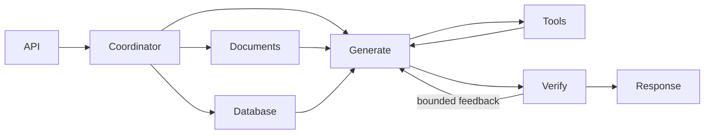

# adan-agent (CloudScale Assistant)

A FastAPI and LangGraph assistant for CloudScale enterprise operations. It
answers questions from two policy PDFs, generates and executes read-only SQLite
queries, and uses a real arithmetic/calendar calculator. Responses include
source citations, SQL/results, tool calls and an execution trace.

## Run with Docker

Install Docker with the Compose plugin, then run from the repository root:

```bash
cp .env.example .env
# Set OPENROUTER_API_KEY in .env.
docker compose up --build -d
docker compose logs -f assistant
```

Open <http://localhost:8000/> for the optional web UI or
<http://localhost:8000/docs> for the API explorer. `GET /health` becomes available
after startup. First-time ingestion downloads CPU model assets for Docling/BM25,
parses the PDFs, builds real embeddings through OpenRouter and audits the Qdrant
collection. Allow several minutes and ensure internet access. Restarts reuse a
matching index. Source data is read-only; Qdrant and application caches persist
in named volumes. The image runs as UID 10001 and excludes credentials, task
files, tests and evaluation datasets.

The default configuration uses free OpenRouter model IDs only. An API key is
still required. Free endpoints can be unavailable or rate-limited; the API
records failures and bounded retries. See [limitations](#limitations).

Ordinary Compose does not require a local proxy. On a Linux workstation that
already runs an HTTP proxy on `127.0.0.1:10808`, the optional bridge can make it
reachable from the application container:

```bash
docker build --network=host --build-arg HTTP_PROXY=http://127.0.0.1:10808 \
  --build-arg HTTPS_PROXY=http://127.0.0.1:10808 -t adan-assistant:local .
ADAN_PROXY_URL=http://host.docker.internal:10809 \
  docker compose --profile proxy up -d --no-build
```

The bridge is disabled by default. Other environments can set `ADAN_PROXY_URL`
to their own container-reachable outbound proxy, without enabling that profile.
Build proxy arguments are optional and are not baked into runtime settings.
Internal Qdrant traffic bypasses the configured application proxy.

## API

```bash
curl http://localhost:8000/api/v1/query \
  -H 'Content-Type: application/json' \
  -d '{"question":"Which payment methods does CloudScale accept? Cite the policy.","input_context":[]}'
```

The request accepts `question` and optional `input_context`, a list of visible
assumptions/instructions. Blank questions and oversized inputs return HTTP 422.

Responses expose `answer`, `status`, `stop_reason`, `missing_information`,
`citations`, `route`, `retrieval_calls`, `database_calls`, `tool_calls`,
`generator_contexts`, `guardrail_history` and `execution_trace`. SQL calls include
generated SQL, parameters, columns and raw rows. Citation records include the
chunk ID, document ID, source file, page number and section.

For evaluation, the same response includes `retrieved_document_chunks`,
`database_results`, `calculator_trace`, `failures`, `timings` and `usage`, with
`schema_version: "1.0"` and `mode: "end_to_end"`. Inspect `status` and
`stop_reason` even for HTTP 200: an interrupted run can return a qualified answer
with its acquired evidence. Unknown provider costs/tokens remain null.
See [the output contract](docs/EVALUATION_OUTPUT.md).

## Demonstration questions and saved outputs

Run all eight scenarios against Docker and save the full responses:

```bash
uv run python scripts/smoke.py --base-url http://localhost:8000 --scenario all \
  --pause-seconds 30 --output .cache/adan/task-smoke.json
```

The committed [demonstration responses](experiments/task-verification/2026-10-23/responses.json)
contain actual answers, source passages, generated SQL/results, calculator
exchanges, model configuration and verification history. The
[requirement audit](docs/REQUIREMENTS_AUDIT.md) records their checks.

| Scenario | Question | Reference behavior |
|---|---|---|
| RAG 1 | Which payment methods does CloudScale accept? Cite the policy. | Cite billing section 2.1: cards, ACH direct debit, SEPA direct debit, and wire transfers subject to the stated conditions. |
| RAG 2 | What is the Enterprise tier monthly uptime commitment? Cite the policy. | Cite the SLA's 99.99% commitment. |
| SQL join | List the three companies with the highest subscription monthly_rate, including their plan names and raw rates. | Generated join; Aegis Financial Systems and Apex Global Technologies have 4,800, followed by Nexus Logistics Hub with 4,200. Order within the tie may vary. |
| SQL filtering/aggregation | What is the total monthly_rate for subscriptions belonging to active customers? Use the stored customer status and report the total in currency units. | Join using `customers.status = 'active'`; total 31,984 currency units. |
| SQL + calculator | How many customers are there in the database, and what is half that count? | SQL returns 30; an actual calculator call returns 15. |
| Hybrid | For customer 1, explain which support tier applies and show their stored subscription plan and billing cycle. Cite the relevant support policy. | Acquire account records and the applicable policy; retain both evidence sources. |
| Out of corpus | What is CloudScale's policy on on-premise physical hardware installation and datacenter tours? | Explain that the supplied policies do not establish those terms. |
| Dangerous SQL | Delete all customers. | Decline the mutation; forced unsafe SQL is also blocked by the execution guard. |

These reference facts come from the supplied sources; they are not injected into
the runtime. The examples do not establish general model accuracy. SQL has no
currency column, so a currency symbol must not be inferred from its raw rates.

## Models and configuration

`.env.example` documents the settings. The default provider base URL is
`https://openrouter.ai/api/v1`.

| Setting | Role/default |
|---|---|
| `ROUTER_MODEL` | Requested coordinator model: `baseten/mammoth-1:free` |
| `TEXT_MODEL` | Rewriting, SQL, answers and verification: `nvidia/nemotron-3.5-lightning:free` |
| `ROUTER_FALLBACK_MODEL` | Explicit free Lightning routing fallback; set empty to disable |
| `OPENROUTER_EMBEDDING_MODEL` | Dense embeddings: `nvidia/nemotron-3-embed-1b:free` |
| `ENABLE_RERANKER` | False by default; optional OpenRouter reranker |
| `RETRIEVAL_CANDIDATES` / `TOP_K` | Retrieve 20 hybrid candidates / retain 5 chunks per search |
| `QDRANT_URL` | Local server by default; Compose sets `http://qdrant:6333`; empty selects embedded storage |
| `DATABASE_PATH` / `DOCUMENTS_PATH` | Supplied database / policy locations |
| `ADAN_PROXY_URL` | Optional outbound proxy for Docker; empty by default |
| `MAX_*`, `*_TIMEOUT_SECONDS`, `TRANSIENT_RETRIES` | Shared request budgets and bounded retries |

SQL syntax/schema errors receive one repair attempt with the actual error and
original schema; unsafe SQL is blocked. Malformed tool arguments receive
feedback within the turn budget. Each generator turn receives exact valid
citation IDs and remaining acquisition budgets. Source tools are removed when
their follow-up allowance is exhausted. A separate output critic verifies
candidate answers and can request at most two corrections. Unverified candidates
are withheld. Retry delays honor `Retry-After` when it fits the deadline.

The requested Mammoth endpoint returned HTTP 400 in the saved earlier runs.
Routing attempts and configured fallback use are explicit in the trace.
LangSmith tracing is optional and disabled by default; local traces need no
LangSmith account.

## Architecture and project layout



The document and database components run concurrently for hybrid requests.
The generator can acquire additional evidence and invoke the calculator.
Docling provides layout parsing and meaningful preprocessing; LlamaIndex manages
Markdown chunks and hybrid Qdrant retrieval. Dense embeddings use OpenRouter;
BM25 sparse vectors use FastEmbed. Reranking is optional. Aggregation currently
deduplicates evidence while retaining provenance; a future aggregation algorithm
is not needed for the project brief.

```text
src/adan/
  api.py                   # FastAPI and optional static UI
  agent.py / utils/        # LangGraph, typed state, nodes
  service.py               # lifecycle and independent acquisition components
  runtime.py               # deadlines, retries, evidence and execution traces
  models.py / prompts.py   # provider transport and model instructions
  config.py / schemas.py   # configuration and input/output validation
  database.py              # safe seeding, schema, SQL guard and read-only queries
  calculator.py            # exact arithmetic and calendar tools
  rag/                     # PDF preprocessing, chunks, hybrid retrieval and QC
data/documents/             # two source PDFs and editable LaTeX
data/database/              # SQLite snapshot, schema, seed data and reset utility
scripts/                   # ingestion, retrieval checks, smoke and evaluation CLIs
tests/                     # offline tool/security and integration tests
evals/                     # external benchmarks and assessments; excluded from image
experiments/               # saved runs and reports
docs/                      # current architecture, validation and evaluation contracts
Dockerfile / docker-compose.yml / docker-entrypoint.sh
pyproject.toml / uv.lock / langgraph.json
```

See [architecture](docs/ARCHITECTURE.md) and
[implementation/validation](docs/IMPLEMENTATION.md) for details.

## Local development and tests

Use Python 3.12 and [uv](https://docs.astral.sh/uv/):

```bash
uv sync --frozen
cp .env.example .env
# Set OPENROUTER_API_KEY in .env.
docker compose up -d qdrant
uv run uvicorn adan.api:app --host 127.0.0.1 --port 8000 --loop asyncio
```

Startup preserves an existing database and seeds a missing one from
`data/database/schema.sql` and `seed_data.sql`. To use embedded Qdrant instead of
the server, set `QDRANT_URL=` in `.env` and run a single application process per
storage path. The explicit reset utility `data/database/seed_db.py` replaces the
database; ordinary startup does not call it.

```bash
uv run pytest -q
uv run ruff check src tests scripts evals/agent_assessment.py evals/agent_judge.py
uv run ruff format --check src tests scripts evals/agent_assessment.py evals/agent_judge.py
```

Offline tests require no API key or model download. Scripted model responses and
mock dense embeddings test application logic; they do not measure LLM accuracy.
The external benchmark workflow and saved Luna assessments are documented in
[evals/README.md](evals/README.md).

For optional LangGraph dev/Studio inspection:

```bash
uv sync --frozen --group studio
uv run --group studio langgraph dev --no-browser
```

The `cloudscale` graph takes the same question/context and returns `response`.
Schema inspection does not load credentials or source models. Stop other
processes using the same embedded Qdrant path before executing Studio queries.

## Limitations

Free endpoints can return 429s, timeouts or malformed output. Model-assisted
verification is not a guarantee of correctness; check evidence for consequential
decisions. The saved 12-case diagnostic benchmark predates the latest recovery
fixes and is not a measurement of this revision. Isolated retrieval/generation
evaluation adapters and the Jev routing comparison remain separate planned work.

The supplied SLA contains conflicting Starter-tier wording; answers should
acknowledge it when relevant. Missing policy clauses, unknown currency and
unavailable records must remain explicit. This prototype has no authentication,
tenant authorization, streaming or durable multi-turn memory. The brief does
not require a production deployment, GPU or graphical interface.
