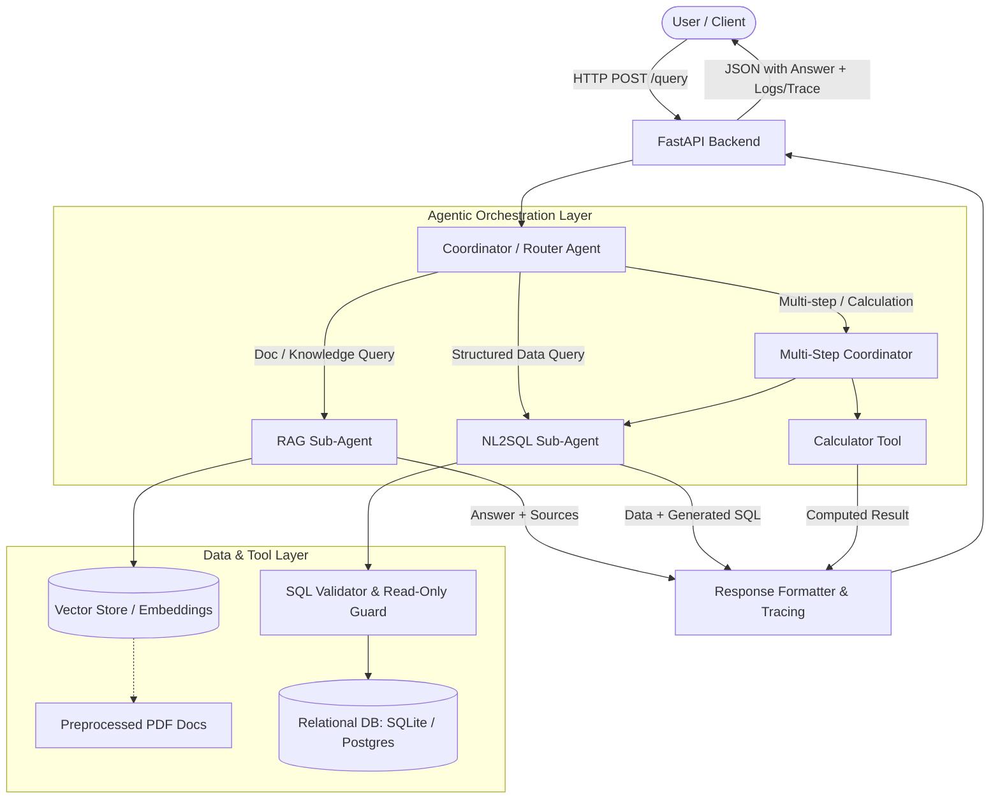

# AI Assistant System Specification (Adan Hiring Project)

> **Source**: `adan-task (1).pdf` — هوش مصنوعی آدان (Adan Artificial Intelligence)  
> **Project Type**: Recruitment Assignment / Prototype Assessment  
> **Target Audience**: AI Coding Agent / Autonomous Developer  
> **Primary Goal**: Build an operational, containerized Agentic AI Assistant capable of routing user queries across unstructured PDF documents (RAG), a relational database (NL-to-SQL), and auxiliary tool calling (Calculator), exposed via a lightweight REST API.

---

## 1. Executive Summary & Core Objective

The goal is to develop a functional, testable, and explainable prototype of an AI Assistant for an internal business/enterprise Q&A scenario. The assistant must intelligently handle multi-modal knowledge sources (unstructured documents and relational databases) and execute multi-step tool workflows when required.

### Core Philosophy & Evaluation Priorities
- **Quality over Quantity**: Solid implementation of core AI components, routing logic, query security, and error handling takes precedence over decorative features or UI complexity.
- **Explainability & Verification**: Generated SQL queries, execution results, retrieved document sources, and agent routing paths must be transparent and inspectable in output responses and logs.
- **Safety & Guardrails**: Strict read-only database operations and robust fallback when documents do not contain requested information (no hallucinations).
- **Execution Environment**: Fully reproducible via Docker / Docker Compose.

---

## 2. High-Level System Architecture



---

## 3. Detailed Component Requirements

### 3.1. Document Preprocessing & RAG Sub-Agent
- **Document Ingestion**:
  - Provide a few small, realistic PDF documents (e.g., Company HR Policy, Expense Reimbursement Guide, Service Level Agreement).
  - Implement at least **one meaningful preprocessing step** prior to ingestion (e.g., header/footer stripping, markdown normalization, structural section chunking, metadata extraction like doc title/page/section).
- **Retrieval & Grounding**:
  - Implement semantic search using an embedding model (e.g., OpenAI `text-embedding-3-small`, HuggingFace `sentence-transformers`, or FastEmbed) stored in a lightweight vector store (e.g., ChromaDB, FAISS, or Qdrant).
  - Context construction: retrieve top-$k$ relevant chunks and supply them to the LLM.
- **Response & Citations**:
  - The final answer must cite the specific source document and section/page.
  - **Strict Anti-Hallucination Guardrail**: If the retrieved documents do not contain the answer, the system must explicitly state that the information is unavailable. Fabricated answers are strictly unacceptable.
- **Scope Note**: Startup ingestion or CLI/script seeding is sufficient; no need for a complex file upload UI or dynamic pipeline.

### 3.2. Natural Language to SQL Sub-Agent (NL2SQL)
- **Database Schema**:
  - Provide a relational database (e.g., SQLite for zero-setup portability, or PostgreSQL) with **at least 2 related tables** and realistic sample seed data.
  - *Recommended Domain*: E-commerce or Corporate Sales (e.g., `customers` and `orders`, or `products` and `sales_transactions`, or `departments` and `employees`).
- **Query Capabilities**:
  - System must translate natural language into valid SQL covering:
    1. **Filtering** (`WHERE`, comparison, date/text filters)
    2. **Aggregation** (`COUNT`, `SUM`, `AVG`, `MAX`, `MIN`, `GROUP BY`)
    3. **Join** (at least one multi-table `JOIN`)
- **Transparency**:
  - The generated SQL query **and** its raw execution result must be inspectable in the response payload or system trace logs.
- **Security & Safety Guardrails**:
  - **Read-Only Enforcement**: Restrict execution strictly to read-only queries (`SELECT`).
  - **Block Dangerous Queries**: Intercept and block DDL/DML statements (`DROP`, `DELETE`, `UPDATE`, `INSERT`, `ALTER`, `TRUNCATE`, `EXEC`).
  - **Error Handling**: Gracefully handle invalid user questions, malformed SQL, non-existent tables/columns, or execution exceptions without crashing.
  - *Note*: Hard-coded queries or static if-else mappings are strictly forbidden; queries must be dynamically generated by the LLM based on schema information.

### 3.3. Coordinator / Router Agent & Sub-Agent Orchestration
- **Agentic Workflow**:
  - The system must feature a Coordinator/Router and at least **two independent specialized sub-agents**:
    1. **RAG Sub-Agent** (for unstructured document inquiries)
    2. **SQL Sub-Agent** (for structured database inquiries)
  - The router determines the appropriate execution path based on the user's prompt.
- **Execution Tracing**:
  - The system must explicitly track and expose in logs/output:
    - Which Sub-Agent was invoked.
    - Which Tools were called (with arguments and outputs).
    - The step-by-step decision path.

### 3.4. Calculator Tool & Multi-Step Workflows
- **Real Calculator Tool**:
  - Implement a real tool using LLM Tool Calling (Function Calling) for mathematical operations (e.g., evaluating expressions, calculating percentages, averages, growth rates, differences).
  - Must not rely on the LLM's internal mental arithmetic for critical numbers.
- **Multi-Step Composite Scenario**:
  - Must demonstrate at least one multi-step scenario:
    - *Example*: Retrieve total quarterly sales from SQL, then use the Calculator Tool to calculate average sale per customer, VAT percentage, or profit margin difference.
    - Coordinator receives user prompt -> calls NL2SQL Sub-Agent -> receives aggregate data -> invokes Calculator Tool -> returns final synthesized answer.

### 3.5. Backend API & Implementation Quality
- **Lightweight REST API**:
  - Built with **FastAPI** (Python).
  - Single unified endpoint (e.g., `POST /api/v1/chat` or `POST /api/v1/query`) and/or dedicated sub-endpoints (`/api/v1/rag`, `/api/v1/sql`).
  - Structured request/response bodies using Pydantic models.
  - Return: final answer, agent/tool execution trace, generated SQL (if applicable), and document sources (if applicable).
- **Error Handling & Resilience**:
  - Input validation (empty prompts, unexpected formats).
  - Managed fallback for LLM rate limits, network timeouts, DB errors, and retrieval misses.
- **Clean Architecture**:
  - Clean separation between API layer, agent routing logic, sub-agent implementations, database connections, and tool definitions.
  - No need for complex enterprise overhead (no full auth/JWT, no microservices, no production CI/CD).

### 3.6. Containerization & Reproducibility (Docker)
- **Container Setup**:
  - Include a self-contained `Dockerfile` and `docker-compose.yml`.
  - Application must launch with a single command: `docker compose up --build`.
  - Automatic database seeding and document vectorization on startup.
- **Configuration**:
  - Provide `.env.example` documenting all required configuration variables (e.g., `OPENAI_API_KEY` or alternate LLM provider keys, model names, ports).

---

## 4. Required Test & Demonstration Scenarios

The implementation must include runnable, verified test cases covering the following scenarios:

| # | Test Scenario Category | Expected Behavior / Test Case |
|---|---|---|
| **1** | **RAG Test 1 (Direct Retrieval)** | User asks a question directly answered by a specific section of the PDF docs. Assistant answers accurately and cites the document name/page. |
| **2** | **RAG Test 2 (Synthesized Retrieval)** | User asks a question requiring synthesis across multiple chunks/sections in the PDF docs. Assistant returns a coherent response with citations. |
| **3** | **RAG Test 3 (Ungrounded / Out-of-Scope)** | User asks a question not present in the documents. Assistant explicitly refuses/states information is not found without hallucinating. |
| **4** | **NL2SQL Test 1 (Filter + Aggregation)** | Query requiring filtering and aggregation (e.g., *"What is the total revenue of completed orders in August 2024?"*). Returns valid `SELECT SUM(...) WHERE ...`. |
| **5** | **NL2SQL Test 2 (Table Join)** | Query requiring joining 2+ tables (e.g., *"List top 5 customers by total purchase amount and their cities"*). Returns valid `JOIN` SQL and table results. |
| **6** | **NL2SQL Test 3 (Security / Dangerous Query)** | Prompt attempting injection or mutation (e.g., *"Delete all inactive users"* or injection string). Guardrail blocks execution; returns safe error response. |
| **7** | **Multi-Step Composite Scenario** | Query requiring DB query + calculation (e.g., *"What is the percentage share of Electronics compared to total company sales?"*). SQL agent gets totals -> Calculator computes percentage -> Final response. |

*Automated test suite (`pytest`) covering core logic, routing, guardrails, and tools is strongly recommended.*

---

## 5. Suggested File & Directory Structure

```text
.
├── docker-compose.yml          # Container orchestration
├── Dockerfile                  # Container build recipe
├── requirements.txt            # Python dependencies (or pyproject.toml)
├── .env.example                # Example environment configuration
├── README.md                   # Comprehensive documentation & execution guide
├── data/
│   ├── documents/              # Sample realistic PDF documents
│   │   ├── hr_policy.pdf
│   │   └── product_catalog.pdf
│   └── database/
│       ├── schema.sql          # DB schema definition (>= 2 related tables)
│       ├── seed_data.sql       # Seed rows for testing
│       └── app.db              # SQLite DB file (generated or seeded)
├── src/
│   ├── __init__.py
│   ├── main.py                 # FastAPI application entrypoint
│   ├── config.py               # Settings, environment variables
│   ├── api/
│   │   ├── __init__.py
│   │   ├── routes.py           # API endpoints (/query, /health, etc.)
│   │   └── schemas.py          # Pydantic request & response models
│   ├── agents/
│   │   ├── __init__.py
│   │   ├── coordinator.py      # Router / Supervisor agent
│   │   ├── rag_agent.py        # PDF RAG Sub-Agent
│   │   └── sql_agent.py        # NL-to-SQL Sub-Agent with guardrails
│   ├── tools/
│   │   ├── __init__.py
│   │   ├── calculator.py       # Deterministic Calculator Tool
│   │   └── sql_guard.py        # SQL validator (read-only verification)
│   ├── rag/
│   │   ├── __init__.py
│   │   ├── preprocessor.py     # Meaningful PDF extraction & cleanup
│   │   └── vector_store.py     # Embeddings & vector index management
│   └── database/
│       ├── __init__.py
│       └── connection.py       # DB connection, schema introspection, execution
└── tests/
    ├── __init__.py
    ├── test_rag.py             # Groundedness, citations, out-of-scope tests
    ├── test_sql.py             # Query generation, joins, aggregation, security
    ├── test_calculator.py      # Math tool verification
    └── test_coordinator.py     # End-to-end routing & multi-step flows
```

---

## 6. Implementation Action Plan for AI Agent

Follow this checklist step-by-step:

- [ ] **Phase 1: Environment & Project Foundation**
  - Set up Python virtual environment / dependencies (`fastapi`, `uvicorn`, `pydantic`, `langchain`/`langgraph` or custom agent loop, `chromadb`/`faiss-cpu`, `pypdf`/`pdfplumber`, `sqlite3`/`sqlalchemy`, `pytest`).
  - Configure `.env.example` with LLM API keys and model parameters.

- [ ] **Phase 2: Relational Database & NL2SQL Sub-Agent**
  - Create sample database schema with 2+ tables (e.g., `customers`, `orders`, `order_items`).
  - Seed realistic records.
  - Implement dynamic schema prompt builder.
  - Implement NL2SQL LLM pipeline.
  - Implement strict SQL safety validator (only `SELECT`, regex/AST-based statement blocker).
  - Capture and expose generated SQL, query parameters, and tabular results.

- [ ] **Phase 3: Sample PDF Documents & RAG Sub-Agent**
  - Create or select 2 realistic, concise PDF documents.
  - Implement a dedicated preprocessor (clean whitespace, headers, build structured chunks with metadata).
  - Ingest into vector store with embeddings.
  - Implement RAG retrieval pipeline with top-$k$ similarity search.
  - Implement prompt with strict anti-hallucination instruction: *"If answer is not in context, state: 'Information not found in available documents.'"*
  - Format output to include source document and page/section citation.

- [ ] **Phase 4: Calculator Tool & Orchestrator (Coordinator Agent)**
  - Implement `calculator` tool with safe evaluation (e.g., Python `numexpr` or AST parser).
  - Implement Coordinator / Router agent to classify user intent:
    - Route to `rag_agent` for document queries.
    - Route to `sql_agent` for structured tabular queries.
    - Coordinate multi-step queries (SQL Sub-Agent -> Calculator -> Synthesis).
  - Include complete execution trace metadata in output (invoked sub-agents, tools called, execution time).

- [ ] **Phase 5: API Layer & Error Management**
  - Build FastAPI endpoints with Pydantic request/response validation.
  - Provide clean error handlers for empty input, LLM API timeouts, DB errors, and malicious inputs.

- [ ] **Phase 6: Testing & Quality Assurance**
  - Implement automated `pytest` test suite covering:
    - RAG retrieval accuracy and out-of-scope refusal.
    - NL2SQL join, aggregation, and rejection of dangerous queries (`DROP TABLE`).
    - Calculator operations and multi-step composition.
    - Coordinator routing accuracy.

- [ ] **Phase 7: Dockerization & Delivery Documentation**
  - Build and verify `Dockerfile` and `docker-compose.yml`.
  - Write comprehensive `README.md` containing:
    - Architectural diagram & design choices.
    - Step-by-step launch commands (`docker compose up --build`).
    - API usage examples (`curl` requests and JSON responses).
    - Demonstration of all required test scenarios.
    - Limitations and future production considerations.

---

## 7. Submission Checklist & Deliverables

As required by Adan AI evaluation guidelines:
1. **GitHub Repository**: Accessible repository URL.
2. **Complete Source Code**: Clean, well-structured, PEP8 compliant code.
3. **Container Configuration**: Tested `Dockerfile` and `docker-compose.yml`.
4. **Data Artifacts**: Sample PDF documents, DB schema & seed scripts, `.env.example`.
5. **Documentation (`README.md`)**:
   - Docker execution instructions.
   - API / Model configuration guide.
   - Example requests & responses for each capability.
   - Architectural overview and limitations.
6. **Demonstration of Test Scenarios**: Sample output logs for RAG, NL2SQL, security test, and the multi-step Agent+Calculator scenario.

