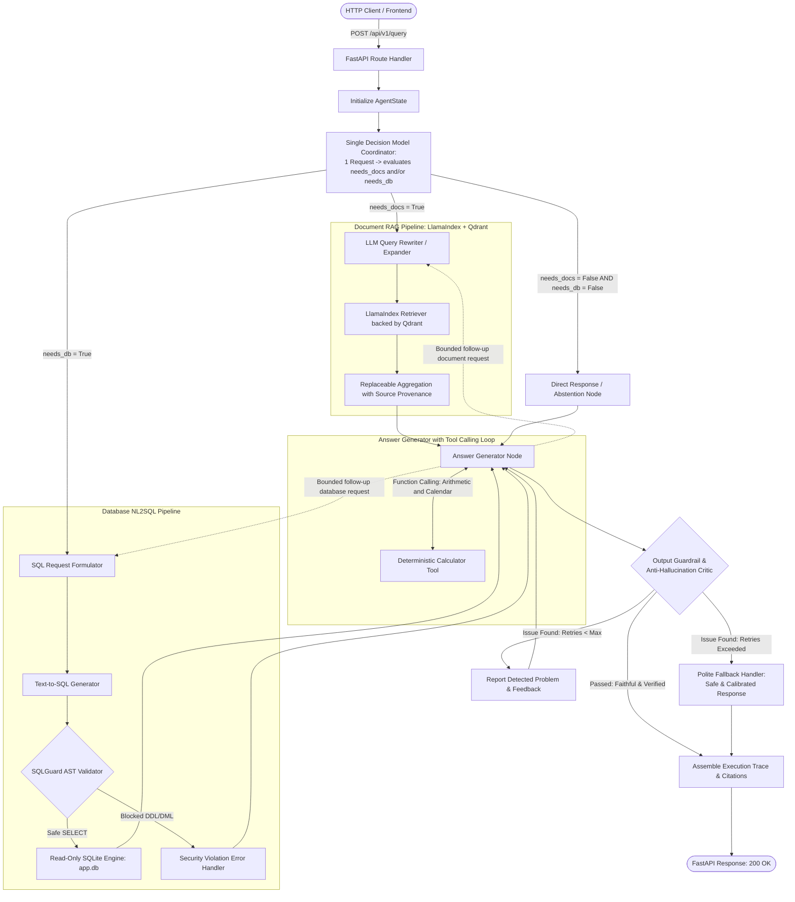
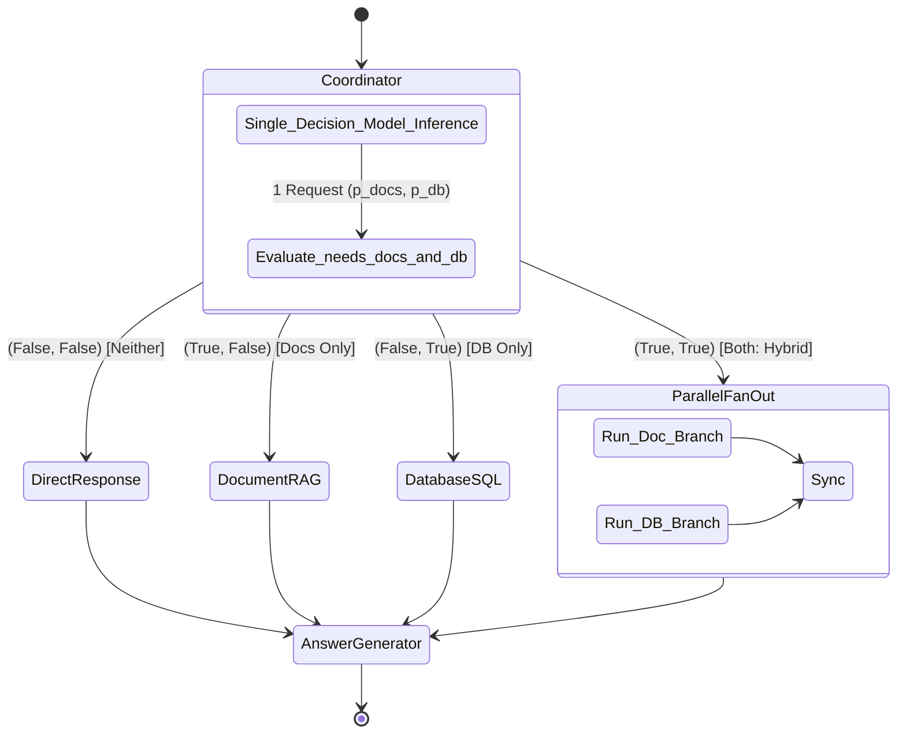
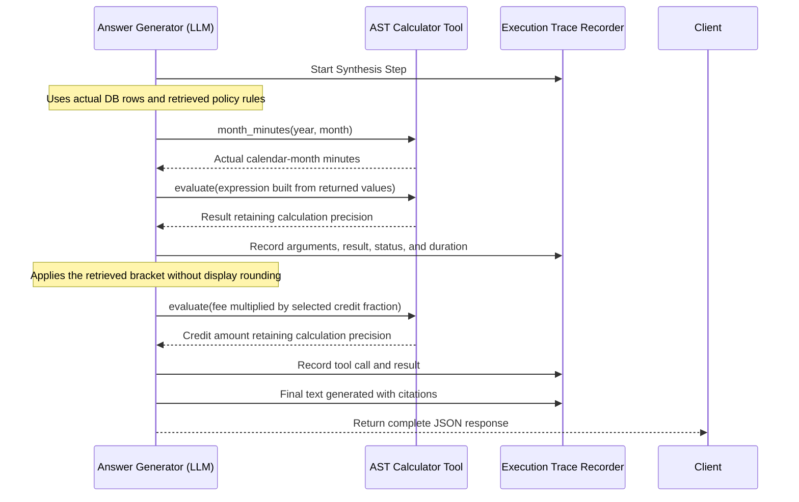
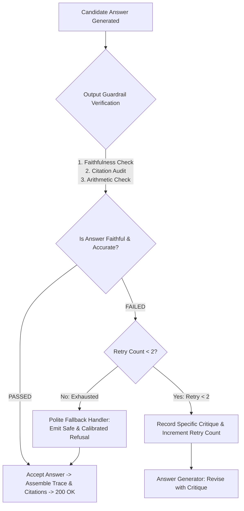

# System Architecture Specification: CloudScale Agentic AI Platform

**Document Version:** 1.1.0  
**Effective Date:** 2026-10-22  
**Target System:** CloudScale B2B SaaS Enterprise AI Assistant  
**Author:** AI Systems Architecture Team  
**Status:** Revised implementation specification; aggregation algorithm pending  

---

## 1. Architectural Philosophy & Executive Summary

The CloudScale Agentic AI Platform is built as a **Decoupled Fan-Out / Fan-In Agent Architecture with Reactive Fallbacks**, orchestrated using **LangGraph** over an explicit, typed state machine (`AgentState`).

The architecture separates concerns into specialized nodes:
1. **Coordinator / Single Decision Model Router**: Uses a dedicated, single decision-based model (System 1 decision engine, e.g., TypeSafe Jev or calibrated decision endpoint) that evaluates document and database requirements (`needs_docs`, `needs_db`) simultaneously in a single forward pass / API request. This enables deterministic single-domain routing, parallel fan-out for hybrid tasks (when both are True), and zero-tool direct responses (when neither is needed).
2. **Document Pipeline**: Uses **LlamaIndex** for document parsing, node management, and retrieval orchestration, backed by **Qdrant** as the high-performance vector store. Followed by a replaceable map-reduce aggregation stage with page/section provenance. The aggregation algorithm will be designed separately; it is not specified as document concatenation or simple summarization.
3. **Database Pipeline**: Uses a two-phase SQL workflow (Request Formulator $\rightarrow$ Text-to-SQL generator) secured by an AST-based read-only guardrail (`SQLGuard`) and an SQLite read-only connection.
4. **Answer Generator with Tool Calling**: Synthesizes cross-domain findings, requests additional document or database evidence when needed, and invokes a deterministic calculator for arithmetic and calendar operations. The generator owns follow-up retrieval after the initial parallel branches.
5. **Reflective Anti-Hallucination & Output Guardrail**: A dedicated verification critic inspects the candidate response prior to final delivery, checking factual faithfulness against retrieved chunks and database records, auditing citations, and verifying math. If issues are found, it triggers a self-correction cycle back to the generator with specific feedback up to a bounded retry limit (`max_retries = 2`). If issues persist, it emits a polite, calibrated fallback response.
6. **End-to-End Observability**: Every execution step captures tool arguments, results, status, timing, verification verdicts, and evidence provenance. Each retrieval round, SQL execution, aggregation artifact, guardrail evaluation, and generator input is preserved for external evaluation.

---

## 2. High-Level Architecture Diagram



---

## 3. The Single Decision Model Coordinator & 4 Operational States

### 3.1 Single Decision Model Architecture

The Coordinator is implemented using **one single decision-based model** (a "System 1" discriminative decision engine such as TypeSafe Jev, with an adapter fallback to a structured-output LLM). 

Rather than chaining multiple LLM classification calls or asking separate models to judge documents and databases independently, **a single request** to the decision model evaluates both target predicates simultaneously:

1. **`needs_docs`**: Does answering require consulting the supplied CloudScale policy documents (DOC-SLA / DOC-BIL), including verifying missing requested policy information?
2. **`needs_db`**: Does answering require retrieving customer, subscription, or incident database records beyond facts explicitly stated in the prompt/context?

#### Single Request & Output Contract:
```python
# A single request sent to the decision model
decision_input = {
    "query": state["user_query"],
    "input_context": state.get("input_context", []),
    "predicates": [
        "needs_docs",  # target 1
        "needs_db"     # target 2
    ]
}

# The single model responds with calibrated probabilities or booleans in ~20-30ms:
# Output: {"p_docs": 0.94, "p_db": 0.08} -> needs_docs=True, needs_db=False
```

#### Why a Single Decision Model?
- **Ultra-low latency**: Executes in a single non-autoregressive forward pass ($\sim 20\text{--}30\text{ms}$), compared to $500\text{--}1,500\text{ms}$ for generative token-by-token LLMs.
- **Atomic combinatorial reasoning**: Evaluates the `AND`, `OR`, and `NEITHER` relationships in a single semantic evaluation without network roundtrip multiplication.
- **Calibrated thresholding (planned)**: Continuous probability outputs ($p_{\text{docs}}, p_{\text{db}} \in [0, 1]$) would allow threshold calibration (e.g., $p \ge 0.35$ for high-recall document checking). The Jev/model comparison remains open in [TODO.md](../TODO.md).

$$\text{Decision Vector} = \begin{bmatrix} p_{\text{docs}} \\ p_{\text{db}} \end{bmatrix} \xrightarrow{\tau_{\text{docs}}, \tau_{\text{db}}} \begin{pmatrix} \text{needs\_docs} \in \{\text{True}, \text{False}\} \\ \text{needs\_db} \in \{\text{True}, \text{False}\} \end{pmatrix}$$



### 3.2 Detailed Routing Matrix (The 4 States)

1. **State `(False, False)` — Direct / Out-of-Scope**:
   - *Characteristics*: Casual conversation, general knowledge, or completely ungrounded domain questions (e.g., *"What is the weather in Paris?"* or *"Who won the 2022 World Cup?"*).
   - *Action*: Bypasses all retrieval and database tools. Passes directly to the Answer Generator with instructions to politely state that the inquiry is out of scope for CloudScale enterprise operations.

2. **State `(True, False)` — Pure Document RAG**:
   - *Characteristics*: Policy questions, SLA response thresholds, credit brackets, payment methods, or delinquency timelines.
   - *Action*: Activates the Document Pipeline. Database pipeline remains idle.

3. **State `(False, True)` — Pure NL2SQL**:
   - *Characteristics*: Aggregations, customer lists, ticket counts, subscription rates, or join queries across relational tables without policy synthesis.
   - *Action*: Activates the Database Pipeline. Document pipeline remains idle.

4. **State `(True, True)` — Hybrid Multi-Source**:
   - *Characteristics*: Customer-specific SLA calculations, refund eligibility for specific subscriptions, or delinquency enforcement status evaluations.
   - *Action*: Triggers **Parallel Fan-Out**; both initial branches run concurrently (`asyncio.gather`). Wait for each dispatched branch to return a result or structured failure before synthesis. The Answer Generator can then use the returned customer attributes to request more focused policy evidence and continue when that call returns.

Policy questions whose answers may be missing still use document retrieval.
The router must not classify a domain question as out of scope merely because
its answer is uncertain or absent from initial context.

---

## 4. Deep-Dive: Core Sub-Systems

### 4.1. The Document RAG Pipeline (`src/rag/`)

```
User Query or Generator Follow-up ──► [Query Rewriter] ──► [Vector Store top-k] ──► [Replaceable Aggregation] ──► [Generator]
```

1. **Query Transformation Node (`src/rag/query_transformer.py`)**:
   - Deconstructs compound or conversational queries into 1–2 focused, semantic search strings optimized for dense retrieval.
   - Retains the original question and visible `input_context`; follow-up queries may additionally use facts returned by SQL. The search instruction must not embed benchmark answer keys or expected source-selection flags.
2. **LlamaIndex & Qdrant Vector Store Architecture (`src/rag/vector_store.py`)**:
   - **LlamaIndex Integration**: Implements document ingestion, node parsing, and retrieval abstractions using `llama-index-core`:
     - Documents are ingested into LlamaIndex `Document` structures.
     - Section-aware chunking splits text along LaTeX structural boundaries into `TextNode` objects, with metadata preserving exact provenance (`doc_id`, `source_file`, `page_number`, `section_title`, `chunk_id`).
   - **Qdrant Storage Engine Backend**: Uses `llama-index-vector-stores-qdrant` (`QdrantVectorStore`):
     - *Embedded / Local Disk Mode*: Persistent on-disk directory (`path="data/qdrant_storage"`) or in-memory (`:memory:`) for lightweight execution and zero-dependency unit tests.
     - *Server Mode*: Configurable via `QDRANT_URL` (e.g., `http://qdrant:6333` in `docker-compose.yml`) for production container deployment.
   - **Collection Specification**:
     - Collection name: `cloudscale_policies`.
     - Distance metric: `Cosine`.
     - Embeddings: `fastembed` (via `llama-index-embeddings-fastembed`) or `sentence-transformers` (`all-MiniLM-L6-v2`, 384 dimensions).
   - **Node Payload Schema in Qdrant**:
     ```json
     {
       "doc_id": "DOC-SLA-2024-V2",
       "source_file": "sla_and_support_tier_policy.pdf",
       "page_number": 3,
       "section_title": "4.2 Service Credit Brackets",
       "chunk_id": "sla_sec4_2_p3",
       "text": "Table 2: Service Credit Compensation Brackets..."
     }
     ```
   - **LlamaIndex Retriever Engine**:
     - Built via `VectorStoreIndex.from_vector_store(vector_store=qdrant_store)`.
     - The retriever (`index.as_retriever(similarity_top_k=5)`) queries Qdrant with dense vectors and optional payload filters (`MetadataFilters`), returning `NodeWithScore` objects directly to the Map-Reduce aggregation pipeline.
3. **Map-Reduce Context Aggregation (`src/rag/context_builder.py`)**:
   - The algorithm and its internal representation are intentionally open for a later design. It may transform, select, organize, or aggregate evidence; this specification does not prescribe a union, lexical filter, summary, or extra LLM call.
   - The interface accepts the question, visible context, and source-tagged retrieved chunks. It returns a generator-consumable artifact with provenance links to its source chunk IDs and document locations.
   - Preserve immutable raw retrieval results separately from the aggregation artifact. Record the artifact and the exact evidence content supplied to each generator turn. This records stage boundaries without restricting the future aggregation algorithm.
   - Preserve the provenance of exceptions, thresholds, tables, and conflicting clauses so policy claims can cite their actual sources. Aggregated text alone is not a substitute for the original evidence when resolving citations.
4. **Anti-Hallucination Guardrail**:
   - Prompt constraint: *"Answer every part supported by the supplied evidence and explicit user facts. If some facts are missing, explain what can be established, identify the missing information, and qualify the unresolved conclusion. If relevant clauses conflict, cite both and describe the uncertainty. If no substantive part can be answered, state that the requested information is unavailable. Never invent policies, database facts, prices, dates, or outcomes."*
   - Distinguish absence of supporting information from a failed tool call. A timeout is an acquisition failure, not proof that the documents contain no answer.

---

### 4.2. The Database NL2SQL Pipeline (`src/database/` & `src/tools/`)

```
User Query ──► [SQL Formulator] ──► [NL2SQL Generator] ──► [SQLGuard AST Check] ──► [SQLite Execution (RO)]
```

1. **SQL Request Formulator Node (`src/agents/sql_formulator.py`)**:
   - Maps natural language intent to concrete database entities, date windows, and column filters.
   - Example: Translates *"February 2024 incidents"* into `reported_at >= '2024-02-01T00:00:00Z' AND reported_at < '2024-03-01T00:00:00Z'`.
2. **Text-to-SQL Generator (`src/agents/sql_agent.py`)**:
   - Dynamically inspects the SQLite schema (`customers`, `subscriptions`, `incident_tickets`) via `PRAGMA table_info` / `schema.sql`.
   - Generates compliant, read-only SQLite syntax. Never uses hardcoded queries.
3. **SQLGuard Safety Validator (`src/tools/sql_guard.py`)**:
   - Uses AST parsing (`sqlglot`) to inspect the abstract syntax tree.
   - **Enforces**: Exactly 1 statement, statement type must be `SELECT`.
   - **Blocks**: All mutations (`INSERT`, `UPDATE`, `DELETE`), DDL (`DROP`, `ALTER`, `CREATE`), PRAGMA writes, `ATTACH DATABASE`, and multi-statement semicolons (SQL injection mitigation).
4. **SQLite Read-Only Connection (`src/database/connection.py`)**:
   - Opens SQLite in URI mode: `file:data/database/app.db?mode=ro`.
   - SQLite rejects writes through this connection. The URI does not itself change operating-system file permissions.

---

### 4.3. The Answer Generator & Tool-Calling Loop (`src/agents/synthesizer.py`)

The Answer Generator synthesizes evidence and uses LLM Function Calling to acquire
missing evidence or run calculations. After the initial parallel branches, it can
request `search_documents(query)` or `query_database(request)`. Each call follows
the same preprocessing, aggregation, validation, and tracing path as the initial
request, returns its result to the generator, and consumes the shared request
budget. No fallback may bypass the SQL guard.

The generator can therefore use a returned account's tier or billing cycle in a
second policy search. It must distinguish user-provided assumptions, returned DB
facts, policy evidence, and calculated conclusions throughout the loop.



#### Deterministic Calculator (`src/tools/calculator.py`)

Expose three typed operations through the calculator tool:

| Operation | Inputs | Result |
|---|---|---|
| `evaluate` | `expression`: numeric arithmetic expression | Numeric result with calculation precision preserved |
| `date_difference` | `start_date`, `end_date`: ISO `YYYY-MM-DD` | Signed integer `(end_date - start_date).days`, in calendar days |
| `month_minutes` | Integer `year`, `month` | Days in that calendar month multiplied by 24 and 60, in UTC minutes |

- Arithmetic uses an allowlisted AST interpreter, without Python `eval()`. Allow numeric constants, unary plus/minus, addition, subtraction, multiplication, division, exponentiation, and modulo. Reject booleans, names, function calls, attribute access, non-finite values, and division by zero.
- Bound expression length to 1,000 characters, AST size to 100 nodes, absolute exponent to 100, and numeric operand/result magnitude to `1e100`. Return structured validation errors; parsing an AST alone does not make arbitrary computation safe.
- Calendar operations use `datetime.date` and `calendar.monthrange`; validate real dates, years 1–9999, and months 1–12. Count calendar days, not business days. Apply any filing-cutoff interpretation from the visible question context rather than inventing one in the tool.
- Retain exact rational arithmetic for comparisons when division repeats; serialize the exact numerator/denominator with a decimal rendering for the LLM. Use `Decimal` and `ROUND_HALF_UP` for monetary display. Never select a policy bracket from a result rounded for display.
- Tool results include the operation, normalized inputs, value, units, and status. The generator receives the actual results; it does not invent date differences or month lengths. The tool performs math, not hidden policy lookup.

### 4.4. Bounded Follow-ups and Stop Behavior

The following defaults are shared across the whole request, including initial
branches, generator follow-ups, and retries. Record effective values with each
run; experiment configuration may override them explicitly.

| Limit | Default | Counting rule |
|---|---:|---|
| Document follow-up invocations | 2 | Generator-requested document-pipeline calls after initial routing |
| Database follow-up invocations | 2 | Generator-requested SQL-pipeline calls after initial routing, including SQL repair requests |
| Total tool executions | 24 | Every actual search, SQL execution, or calculator execution, including retries |
| Generator turns | 12 | Every answer-generator model invocation, including turns after tool results |
| Transient retries | 1 | One additional attempt per failed operation, for timeout/rate-limit/transient transport failures only |
| Request wall time | 120 seconds | Shared deadline beginning at request entry |
| Tool attempt time | 20 seconds | Capped by the remaining request wall time |
| Model attempt time | 30 seconds | Capped by the remaining request wall time |
| Guardrail self-correction retries | 2 | Maximum correction feedback cycles returned to Answer Generator |

Reserve budget before dispatch, including parallel dispatch, so concurrency cannot
exceed the total. A pipeline failure does not reset counters. Retries repeat the
same operation; a revised query is a follow-up, not a free retry. Security blocks
are not retried. All database calls retain read-only enforcement.

When a limit is reached, stop dispatching calls and return already-supported
findings, the unresolved parts, and an explicit stop reason. If the wall deadline
leaves no time for another model call, use a deterministic response envelope with
available results and the interruption reason. Do not claim that the task was
fully answered or that missing evidence was proven absent. A captured limit hit
is a completed, budget-limited system outcome; evaluator or trace-capture failure
is a separate invalid evaluation.

### 4.5. Reflective Anti-Hallucination & Output Guardrail Loop

Before final delivery to the client, every generated candidate response passes through a dedicated **Output Guardrail Node** (`src/agents/output_guard.py`) implementing a reflective verification loop:



#### 1. Core Verification Checks:
1. **Faithfulness & Groundedness**: Compares every material factual claim against the actual retrieved LlamaIndex nodes and database query results in the current state.
2. **Citation Audit**: Verifies that cited document IDs (e.g. `DOC-SLA-2024-V2`, `DOC-BIL-2024-V3`), page numbers, and section titles match the provenance of the retrieved context.
3. **Numeric & Math Audit**: Verifies that any reported numbers, percentages, or calculated currency amounts match the logged calculator tool outputs or database rows.
4. **Appropriate Abstention**: Confirms that if information was missing, the answer appropriately qualified or declined rather than fabricating facts.

#### 2. Feedback and Self-Correction Cycle:
- When a discrepancy is detected, the guardrail generates a targeted, structured critique (e.g., *"Critique: Claimed that annual cancellation requires 48 hours notice without mentioning Section 1.3's 30-day requirement. Reconcile both clauses."*).
- The critique is appended to `state["guardrail_feedback"]`, `state["guardrail_retry_count"]` is incremented, and LangGraph cycles execution back to the Answer Generator node.
- The Answer Generator inspects the critique and generates a revised response addressing the specific defect.

#### 3. Bounded Iterations and Polite Fallback:
- **Strict Limit**: Bounded to at most **2 correction iterations** (`guardrail_retry_count <= 2`) to guarantee predictable response times and prevent infinite cycling.
- **Polite Fallback Handler**: If verification fails after 2 attempts, the system bypasses the ungrounded output and returns a safe, polite fallback response:
  > *"I apologize, but I could not verify all details of this response with complete certainty against CloudScale's official policy documentation and database records. To ensure accurate guidance, please contact CloudScale support at support@cloudscale.io."*
- The full audit history, detected problems, and fallback trigger are recorded in `state["execution_trace"]` for diagnostic analysis.

---

## 5. The Centralized State Schema (`src/agents/state.py`)

All nodes interact strictly through the typed `AgentState` dictionary:

```python
from operator import add
from typing import Annotated, TypedDict, Optional, List, Dict, Any, Literal

class Citation(TypedDict):
    document_id: str
    source_file: str
    page_number: int
    section_title: str
    quote_snippet: Optional[str]

class TraceStep(TypedDict):
    event_id: str
    run_id: str
    call_id: str
    parent_call_id: Optional[str]
    dispatch_sequence: int
    step_number: int
    node_name: str
    action_type: str  # route, retrieval, aggregation, sql, calculator, generation
    status: Literal["started", "succeeded", "failed", "blocked", "cancelled"]
    inputs: Dict[str, Any]
    outputs: Dict[str, Any]
    error: Optional[Dict[str, Any]]
    duration_ms: float

class AgentState(TypedDict):
    # Inputs retained throughout the workflow
    run_id: str
    user_query: str
    input_context: List[str]

    # Initial routing decisions
    needs_docs: bool
    needs_db: bool
    route_description: str

    # Immutable histories; follow-ups append rather than overwrite evidence
    retrieval_calls: Annotated[List[Dict[str, Any]], add]
    aggregation_artifacts: Annotated[List[Dict[str, Any]], add]
    generator_contexts: Annotated[List[Dict[str, Any]], add]
    database_calls: Annotated[List[Dict[str, Any]], add]
    tool_calls: Annotated[List[Dict[str, Any]], add]
    execution_trace: Annotated[List[TraceStep], add]

    # Latest database result; complete history remains in database_calls
    formulated_sql_request: Optional[str]
    generated_sql: Optional[str]
    sql_is_safe: bool
    raw_sql_results: Optional[List[Dict[str, Any]]]
    sql_error: Optional[str]

    # A request-local controller reserves shared budgets before dispatch
    effective_limits: Dict[str, Any]
    budget_snapshot: Dict[str, Any]
    branch_outcomes: Dict[str, Any]

    # Reflective output verification & guardrail feedback
    guardrail_retry_count: int
    guardrail_feedback: Optional[str]
    guardrail_verdict: Literal["passed", "failed", "fallback", "skipped"]

    # Final fields owned by the answer generator/response assembler
    final_answer: Optional[str]
    citations: List[Citation]
    answer_status: Literal["complete", "partial", "insufficient_evidence", "error"]
    stop_reason: str  # completed, insufficient_evidence, tool_limit, turn_limit, deadline, tool_error
    total_duration_ms: float
```

This is a state contract for implementation, not existing application code.
Initialize histories to empty lists and optional results to `None`. Nodes return
only their new history entries; reducers append them once. Shared budget
reservation must be atomic; parallel nodes must not independently increment and
overwrite a common counter. The join writes `branch_outcomes` after every active
initial branch has completed or failed.

Every retrieval call records original and transformed queries, filters, round,
ranked chunk text, chunk IDs, source locations, scores and score semantics,
attempt number, and timing. Every SQL call records its request, generated SQL,
bound parameters, column names, raw rows, and guard/execution outcome. Aggregation
records link input chunk IDs to the returned artifact. Generator-context records
capture the exact visible input, evidence, and tool messages for that turn.
Calculator calls record arguments and results at calculation precision.

Use call and parent IDs to associate concurrent work and follow-ups. Reserve a
dispatch sequence before asynchronous execution and record completion timestamps;
completion order is not a reliable query ranking. Do not silently truncate trace
payloads needed for evaluation. A final response exposes the full evidence bundle
and histories, including failures and stop reason. Record observable decisions
and tool exchanges, not private model reasoning or credentials.

---

## 6. Critical Engineering Notes & Implementation Constraints

### 1. Zero Mental Arithmetic Rule
- **Mandate**: Derived numerical results must come from the calculator tool.
- **Enforcement**: System prompt instructs the synthesizer: *"Use the calculator for arithmetic and calendar calculations. Use returned values in your answer and preserve their precision until display. Quoting numerical facts already supplied by the user, documents, or database does not require recalculating them."*

### 2. Time & Calendar Arithmetic Precision
- Use calendar operations for actual UTC month lengths, including leap years.
- **Rounding Convention**:
  - Displayed uptime percentages: Round to 6 decimal places.
  - Bracket comparisons: Use the retained exact value, not binary floats or a displayed rounded value.
  - Monetary values: Round to 2 decimal places using `ROUND_HALF_UP`.
  - Unit of Account: When database currency is unstated, label strictly as **currency units**; never assume USD or EUR unless explicitly documented.

### 3. Strict Boundary Inequalities
- Retrieve eligibility thresholds, filing windows, and credit brackets from the policy documents. Preserve inclusive/exclusive boundaries and units exactly; do not bake their current values or benchmark conclusions into prompts or calculator code.

### 4. Qualified Answers and Evaluation Isolation
- Answer supported parts, identify missing facts, and acknowledge conflicting evidence. Use complete abstention only when no substantive answer is supported. Never turn missing information into either an automatic approval or an automatic rejection.
- Runtime prompts describe these general behaviors. Keep benchmark questions, answers, reference SQL, expected rows/calculations, and known missing-information conclusions in `evals/`, outside application prompts, indexing, caches, and agent-accessible files.
- Carry the user's `input_context` through routing, follow-ups, aggregation, and synthesis. Explicit hypothetical assumptions remain user inputs, not facts supposedly stored in the database.
- Controlled reference evidence is injected only in the external generation evaluation mode described below; it is never supplied to ordinary end-to-end runs.

### 5. Latency & LLM Call Optimization
- **Async Concurrency**: In hybrid state `(True, True)`, execute the initial Document Pipeline and Database Pipeline via `asyncio.gather`.
- **Aggregation**: Keep it replaceable; do not choose its algorithm or assume it requires an LLM before the separate aggregation design is available.
- **Bounded Work**: Enforce the shared limits in §4.4 and record tool/model durations, token use, and provider-reported cost where available. Unknown cost remains unknown.
- **Caching**: Cache schema introspection results so the database schema is not re-queried on every turn. Do not cache benchmark answers.

---

## 7. Mapping Architecture to Evaluation Scenarios

The architecture directly addresses all 7 mandatory hiring evaluation scenarios:

| # | Scenario from Task Specification | Handling Sub-System | Verification Mechanism |
|---|---|---|---|
| **1** | **Direct RAG Retrieval** | Document Branch (`needs_docs=True, needs_db=False`) | LlamaIndex + Qdrant top-$k$ $\rightarrow$ direct answer with page & section citations. |
| **2** | **Synthesized RAG Retrieval** | Document Branch with replaceable aggregation | Combines supporting evidence across sections with source provenance. |
| **3** | **Ungrounded / Out-of-Scope** | Qualified-answer guardrail in Synthesizer | Answers supported parts and identifies unresolved parts; abstains when no substantive answer is available. |
| **4** | **NL2SQL Filter + Aggregation** | Database Branch (`needs_docs=False, needs_db=True`) | Formulator $\rightarrow$ Text-to-SQL (`SELECT SUM(...) WHERE ...`) $\rightarrow$ SQLGuard. |
| **5** | **NL2SQL Multi-Table Join** | Database Branch with dynamic schema prompt | Multi-table join across `customers`, `subscriptions`, and `incident_tickets`. |
| **6** | **Security: Block DDL/DML** | `SQLGuard` AST Validator | Traps `DROP TABLE`, `UPDATE`, `INSERT`, returning safety violation error. |
| **7** | **Multi-Step Composite Flow** | Hybrid Fan-Out + Synthesizer Tool Calling | SQL returns downtime/rate $\rightarrow$ RAG returns bracket $\rightarrow$ Calculator computes uptime and credit $\rightarrow$ Synthesizer produces final response with trace. |

### External Benchmark: Three Evaluation Modes

The benchmark evaluates three capabilities using the existing 48 questions. It
does not create a question bank or score for every internal node. The evaluator
runs outside the application and uses the same source snapshot and evidence
contracts in all modes.

| Mode | Execution boundary | Assessment |
|---|---|---|
| `retrieval` | Normal source acquisition, including SQL and generator-controlled document/SQL follow-ups; stop before final-answer synthesis | Document evidence recall, all-evidence coverage, context precision, and hybrid DB-result correctness |
| `generation` | Supply reference document passages and reference DB rows to the normal aggregation/generation path; disable retrieval and SQL, retain the real calculator | Correctness, completeness, faithfulness, citations, relevance, uncertainty, and calculation/tool use with controlled evidence |
| `end_to_end` | Full ordinary query path; provide only the question, visible context, and allowed source access | Final response quality plus actual retrieval coverage, SQL facts, calculator use, latency, and termination |

The full mode definitions, evidence-injection boundaries, metric denominators,
and report contract are in [EVALUATION.md](EVALUATION.md). The model is never given
the expected answer or judge rubric. Application and benchmark runner code are
still pending; these modes specify their interfaces and behavior.

---

## 8. Directory Layout & File Organization

The architecture maps cleanly to the file tree:

```
src/
├── api/
│   ├── routes.py          # FastAPI endpoints (POST /api/v1/query, GET /health)
│   └── schemas.py         # Pydantic request/response schemas
├── agents/
│   ├── state.py           # TypedDict AgentState definition
│   ├── coordinator.py     # Single Decision Model Coordinator (evaluates needs_docs and/or needs_db)
│   ├── rag_agent.py       # Query transformer & replaceable aggregation interface
│   ├── sql_agent.py       # SQL request formulator & Text-to-SQL generator
│   ├── synthesizer.py     # Answer generator with calculator tool binding
│   └── output_guard.py    # Reflective anti-hallucination critic & verification loop
├── tools/
│   ├── calculator.py      # Deterministic arithmetic and calendar operations
│   └── sql_guard.py       # AST-based SQL safety and read-only validator
├── rag/
│   ├── preprocessor.py    # LlamaIndex PDF ingestion & node parsing
│   ├── vector_store.py    # LlamaIndex VectorStoreIndex backed by Qdrant
│   └── context_builder.py # Replaceable aggregation and source provenance
├── database/
│   └── connection.py      # SQLite read-only URI connection & schema inspector
├── config.py              # Pydantic BaseSettings & environment variables
└── main.py                # FastAPI application initialization & graph bootstrapper
```

---

## 9. Implementation Status

The policies, database snapshot, 48-case JSONL benchmark, and local answer-key
validator exist. The application, external evaluation runner, and replacement
aggregation algorithm remain to be implemented. This specification does not
claim measured model performance.

Continue with [TODO.md](../TODO.md). Keep retrieval, generation, and end-to-end
reports separate as defined in [EVALUATION.md](EVALUATION.md).
