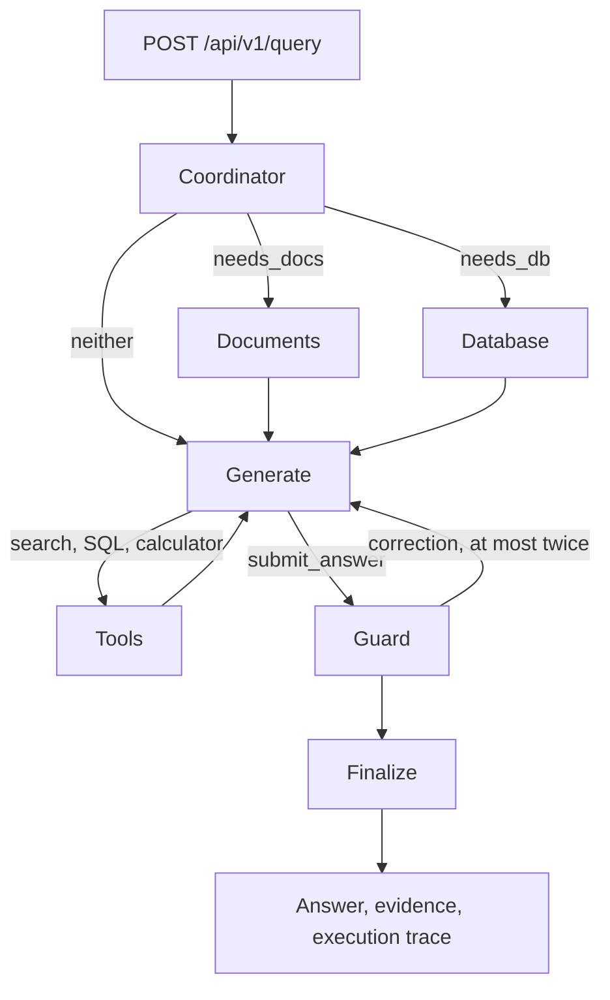

# CloudScale assistant architecture

This describes the implemented application. FastAPI accepts a question and
optional visible context. A LangGraph workflow routes it to independent document
and database components, generates an answer with tools, verifies the candidate,
and returns the answer with its evidence and trace.

## Graph and request state

`src/adan/agent.py` compiles the graph; `utils/state.py` defines its typed input,
output and state. Nodes live in `utils/nodes.py`. Each HTTP request creates its
own `runtime.Run`, which holds evidence, model/tool histories, counters and a
shared deadline. Initial document and database branches run concurrently when
both routing flags are true, then converge on generation. Follow-up tools reuse
the same acquisition components and request budgets.

The coordinator uses one structured model response with two validated Booleans:
`needs_docs` and `needs_db`. A separately configured model can provide a traced
fallback. This implementation does not use Jev, calibrated routing probabilities
or a separate routing model comparison.

## Document component

`rag/docling_parser.py` parses the two source PDFs on CPU. Preprocessing strips
running headers and page furniture, normalizes heading levels, preserves tables,
and recovers the uptime equation from the supplied PDF. The parser retains page
spans and source hashes. `rag/node_parser.py` creates hierarchical Markdown chunks
with stable IDs, document IDs, page numbers and section titles. Quality checks
reject unusable chunks before indexing.

`rag/hybrid_store.py` uses real OpenRouter dense embeddings with local FastEmbed
BM25 sparse vectors in Qdrant. The adapter combines dense and sparse retrieval
with equal weights. OpenRouter reranking is optional and disabled by default;
reranker failures retain the initial ranking. Source hashes, parser versions and
embedding configuration identify the collection, so changed inputs use a new
collection. Compose runs a pinned Qdrant server; embedded Qdrant is also supported.

The document component rewrites a request into up to three search strings. The
aggregation adapter deduplicates retrieved chunks and preserves provenance. Its
recorded name is `passthrough-v1-pending-design`; a more elaborate aggregation
algorithm is outside the supplied task's requirements.

## Database component

`service.py` formulates the database request and asks the LLM to generate SQL
using the actual schema. `database.py` executes a single read-only SELECT,
including filtering, aggregates, joins and permitted CTEs. It applies SQLGlot AST
validation, table/function authorization, an SQLite read-only URI, `query_only`,
a progress timeout and a 200-row response limit. SQL, bound parameters, columns,
rows and truncation are returned as inspectable evidence.

Syntax and column errors receive one repair attempt with the original schema and
actual error. Unsafe SQL is blocked without repair. The three related tables are
`customers`, `subscriptions` and `incident_tickets`. Startup seeds a missing
database from the supplied SQL files and preserves existing databases.

## Calculator, generation and verification

The generator receives the question, visible context and acquired evidence. It
can call `search_documents`, `query_database` and `calculate`, then finish using
`submit_answer`. The calculator is an allowlisted arithmetic AST interpreter
using exact fractions, with calendar operations for real month lengths and date
differences. It does not execute Python `eval` or look up policy rules.

The generator receives exact valid chunk IDs and remaining follow-up budgets.
Invalid tool arguments receive corrective feedback. Exhausted acquisition tools
are removed, allowing a qualified answer with specific missing information.
Unknown citation IDs are rejected deterministically. A separate LLM critic
checks the candidate against evidence and tool results and can request at most
two revisions. If verification fails or time runs out, the response reports the
interruption and retains evidence; it does not deliver an unverified candidate.
Model verification can still miss factual mistakes.

## Limits, API and deployment

Default limits are 120 seconds per request, 30 seconds per model attempt,
20 seconds per tool attempt, 24 actual tool executions, 12 generator turns,
two follow-ups per source and one transient retry per operation. Transient
retries honor `Retry-After` when it fits the deadline. Security blocks are not
retried. Failures and restricted calls remain in the trace.

`api.py` validates input with Pydantic, serves the optional browser UI and exposes
`GET /health`. Responses follow [the evaluation output contract](EVALUATION_OUTPUT.md).
They record observable inputs, tool exchanges, evidence and timing rather than
private model reasoning. Unknown provider usage/cost remains null.

Docker installs locked dependencies, runs as UID 10001 and makes source data
read-only. The image excludes credentials, evaluation datasets and task files.
Ordinary Compose uses direct outbound connections. A local proxy bridge is an
explicit optional profile, documented in the [README](../README.md).

The external evaluator and datasets live under `evals/` and cannot be accessed by
the runtime image. Existing results cover end-to-end and coordinator assessment;
the proposed isolated modes in [EVALUATION.md](EVALUATION.md) remain a separate
design. See [the requirement audit](REQUIREMENTS_AUDIT.md) for acceptance evidence.
